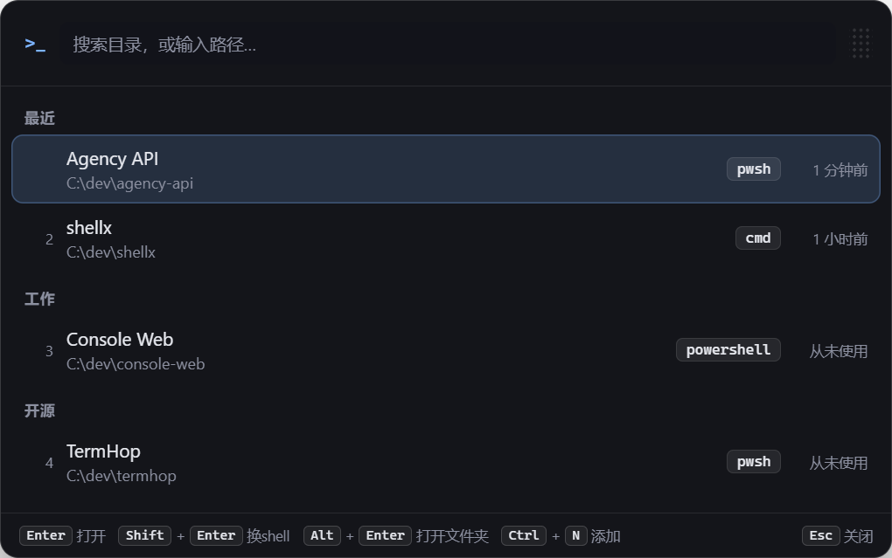

<div align="center">
  
  <h3>TermHop</h3>
  <p>按一个快捷键，在正确的目录、用对的 shell 打开终端。</p>
<br /><br />
  
</div>

TermHop 是常驻托盘的 Windows 小工具。它把你常用的项目目录记下来，按下全局快捷键，
输入几个字母，终端就开在你要的目录、用你要的 shell。

不用再找文件资源管理器在哪一层、右键 Open in Terminal、然后重打那条
又长又容易错的 `cd`；也不用每次都回想自己上次用的是 `pwsh` 还是 `cmd`。

## 适合谁

- 一天要开十几个终端的开发者
- 有那么几个固定项目目录，切换频率很高
- 习惯用 PowerShell 7 / Windows PowerShell / Windows Terminal

## 不适合谁

说实话，下面这些它做不到，别抱期望：

- 只是偶尔开个终端的人——直接右键更快
- 需要在一个窗口里维护多个可复用会话（那更适合 tmux / Windows Terminal 的标签）
- 想在列表里**读到**某个已开终端的当前输出（见[常见问题](#它能接管我已经开着的终端吗)）

## 快速开始

1. 在 [Releases 页面](https://github.com/JAYY513/termhop/releases/latest) 下载
   `TermHop-x.x.x-x64.exe`（安装包）或 `TermHop-x.x.x-x64.zip`（免安装版，解压即用）
2. 启动后，右键托盘图标 → **设置**
3. 添加你的第一个目录（见下一节）
4. 按下 `Ctrl + Space`（默认快捷键，可改）

## 添加目录

**方式一，命令行**（已经在那个目录里了，最快）：

```bash
termhop add .
```

**方式二，启动器里一步到位**：唤起面板，粘上路径，按 `Ctrl + N`（或方向键 `↓` 选到「存为常用目录」再回车）。全程不切窗口。

**方式三，设置里添加**：需要配显示标题、分组、启动命令时用。

第一次用需要先在设置 → **命令行** 里点「安装 termhop 命令」。

## 能做什么

| 功能 | 说明 |
| --- | --- |
| 全局快捷键唤起 | 窗口出现在**光标所在的显示器**上，自动避开任务栏 |
| 模糊搜索 | 标题和路径都能搜，匹配字符高亮 |
| 数字键直达 | `1`–`9` 打开列表第 N 项 |
| 自定义标题 | 项目叫「Agency API」而不是 `agency-api-v2` |
| 分组 | 工作 / 开源 / 临时，按项目归类 |
| 直接开未保存的目录 | 面板里输入路径回车就开，不进列表 |
| 面板内直接保存 | 同一个输入框里 `↓` 一下存成常用目录，不用来回切窗口 |
| 记住上次用的 shell | 默认回车就用你上次在这个目录用的那个 |
| 启动命令 | 可以给每个目录配一句 `npm run dev` |
| 回收站 | 删错了能捡回来，不用重打路径 |
| 开机自动启动 | 可选，开机后静默进托盘，不弹窗 |
| 可拖动 | 拖右上角手柄固定位置，之后从那儿弹出 |

### 启动面板里的快捷键

| 按键 | 作用 |
| --- | --- |
| `Enter` | 用上次用的 shell 打开 |
| `Shift` + `Enter` | 打开 shell 选择器，`↑↓` 选、`Enter` 确认、`1`–`4` 直选 |
| `Ctrl` + `Enter` | 用配置的默认 shell 打开 |
| `Alt` + `Enter` | 在资源管理器里打开这个目录 |
| `1`–`9` | 打开第 N 项（未输入搜索词时生效，只有前 9 项显示序号） |
| `↑` `↓` | 上下移动一项 |
| `Ctrl` + `P` | 向上移动一项 |
| `PageUp` / `PageDown` | 上下翻一屏 |
| `Home` / `End` | 跳到列表首尾（未输入搜索词时生效） |
| `Ctrl` + `N` | 保存当前输入的目录；输入框为空时打开设置里的添加表单 |
| `Ctrl` + `,` | 打开设置 |
| `Esc` | 关闭（在 shell 选择器里先返回列表，再按一次才关闭） |

## 打开一个没保存的目录

面板里直接输入路径就行：

```
C:\work\somewhere
D:\code\thing
```

输入框下面会出现两行：

```
C:\work\somewhere        在此路径打开终端（不会保存）   open
C:\work\somewhere        存为常用目录                 pwsh
```

第一行回车开终端，**不会**加进列表——一次性的目录不该变成永久记录。
第二行回车存下来。已经在列表里的路径不会显示第二行。

第二行右边的 `pwsh` 是**存下来之后会用哪个 shell**，不是它现在会开哪个。
它和第一行回车实际用的是同一个选择，所以你刚用哪个 shell 开过，存下来之后还是那个。

存完之后搜索框会换成这个目录的名字、那一行被选中、状态栏显示「已保存 · 回车打开」——
再回车一次就开终端。想配显示标题、分组、启动命令，去设置里的完整表单。

这个特性也让首次使用不再卡住：一个目录都没有的时候，照样可以直接输路径开终端并存下来。

## 面板位置

三种，在 设置 → 启动面板位置 里切：

| 模式 | 行为 |
| --- | --- |
| **跟随光标**（默认） | 在鼠标所在屏幕上、贴着光标出现 |
| **屏幕居中** | 在鼠标所在屏幕上居中，每次位置一模一样 |
| **固定位置** | 从拖动时的那一点弹出 |

默认是**跟随光标**：热键是手在键盘上按的，注意力本来就在光标附近的代码上，面板贴着
出现眼睛不用来回扫。如果你更想要位置可预测、或者在宽屏上不想让面板跳来跳去，就切
「屏幕居中」。

拖动面板右上角的手柄会直接切到「固定位置」；双击手柄可以还原成跟随光标。

固定位置会被夹在当前显示器的可用范围内并留出边距，所以拔掉一台显示器之后它不会飞出
屏幕，也不会紧贴屏幕边缘。

## 命令行

在设置 → 命令行里安装一次（会生成 `termhop.cmd` 并可选加入 PATH）：

```bash
termhop add .                  # 把当前目录加进来
termhop add D:\work\my-project # 也可以指定路径
termhop open agency            # 直接打开某个已保存目录的终端
termhop help
```

App 开着的关着都能用。改动 PATH 只会影响**新开的**终端，已经开着的窗口要重开。

## 配置文件

位置在设置 → 诊断 → 打开配置目录，一般是：

```
%APPDATA%\TermHop\config.json
```

这是**设计成可以手改的**：字段缺失或类型不对会自动修正；写坏了会自动备份成
`config.json.broken-<时间戳>` 并用默认值启动。想用 git 管配置的话，把它软链到你的
dotfiles 仓库就行。

## 常见问题

### 快捷键被别的软件占用了

启动时会弹窗告诉你。进设置 → 通用，点快捷键框重新按一个组合键
（必须含 Ctrl / Alt / Shift 之一，否则会吃掉正常打字），`Esc` 取消。

### 它能接管我已经开着的终端吗？

不能。TermHop 记得「你在哪个目录用过哪个 shell」，但**不能读取、也不能接管一个已经
开着的终端窗口**。

原因很简单：终端窗口是系统开的，不是 TermHop 开的。你手上的进程和它之间没有可以
传输入输出的通道，别的程序也就无法从外面看到它在显示什么、或者替你在里面敲命令。
TermHop 自己开的终端则完全由它掌控。

如果你要的是这个能力，[docs/DECISIONS.md](docs/DECISIONS.md#为什么不接管已打开的终端)
里写了完整的技术原因，以及一条不碰这条通道也能拿到部分会话感的折中路线。

### 怎么让它随系统启动

设置 → 通用 → 勾「开机自动启动」。开机后它会**静默进托盘**，不弹窗、不抢焦点，
快捷键可以直接用。

两点值得知道：

- 它登记的是**当前这个 exe 的位置**。把程序文件夹移动或删掉之后自启会失效，
  需要重新勾一次。用 NSIS 安装包装的话路径在
  `%LOCALAPPDATA%\Programs\TermHop\`，比较稳定。
- 也可以在「任务管理器 → 启动」里直接改。TermHop 设置页显示的是**系统里的真实状态**，
  所以你在那边改了之后重新打开设置就能看到。

开机时如果快捷键被别的软件抢走了，TermHop 不会弹窗烦你——那种情况下在设置里换一个
组合键就行。

### Windows Terminal 没装会怎样

不会有问题。`wt` 只是四个可选项之一，没检测到时设置页的诊断区会显示「未找到」，
其他三个照常用。

### cmd 里配的启动命令不生效

已知限制，见[下面](#已知限制)。

### 安装时提示未知发布者

安装包目前没有代码签名，SmartScreen 会拦一下。免安装的 zip 版不受影响，想先试建议用
zip；点「更多信息 → 仍要运行」也可以继续。

## 已知限制

- **只支持 Windows。** 没有 macOS 和 Linux 版本。
- **Command Prompt 不支持启动命令。** `cmd /k` 的引号解析塞不进
  `cd /d <路径> && <命令>`，硬塞会静默出错。PowerShell 和 Windows Terminal 没有这个问题。
- **不能接管或复用已开的终端**，理由见[常见问题](#它能接管我已经开着的终端吗)。
- **没有代码签名**，见[上面](#安装时提示未知发布者)。

## 参与贡献

欢迎 issue 和 PR，尤其这几类：

- 新的 shell 支持
- 平台细节（你知道某些机器上 `wt` 在哪、某个 shell 需要什么额外参数）
- UI 和交互
- 文档里说得不清楚的地方

动手前请看 [CONTRIBUTING.md](CONTRIBUTING.md)。技术选型和取舍的来龙去脉记在
[docs/DECISIONS.md](docs/DECISIONS.md)，那里面也有一条"分组这个字段到底该不该留"
的开放问题。

## License

[MIT](LICENSE)
